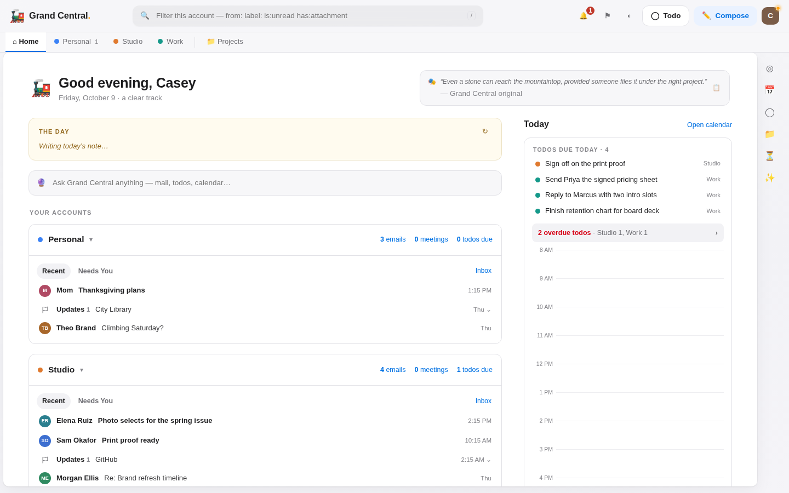
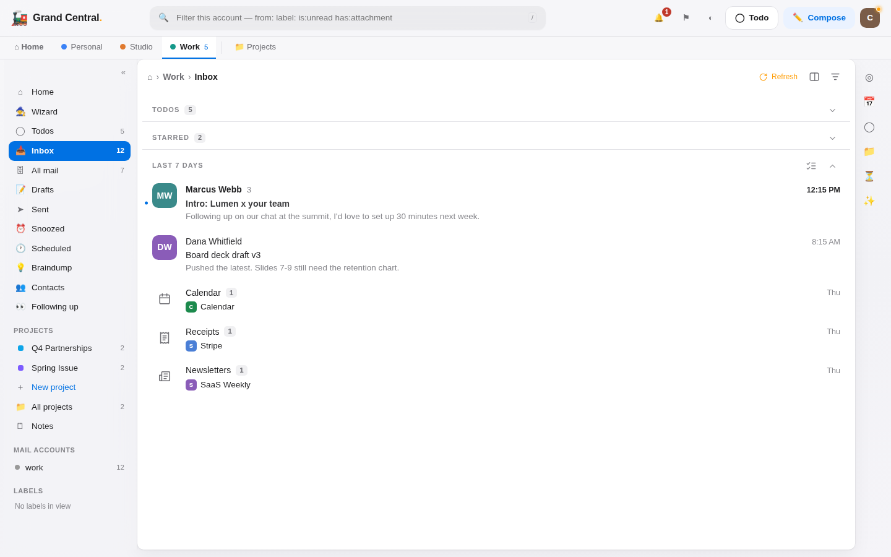
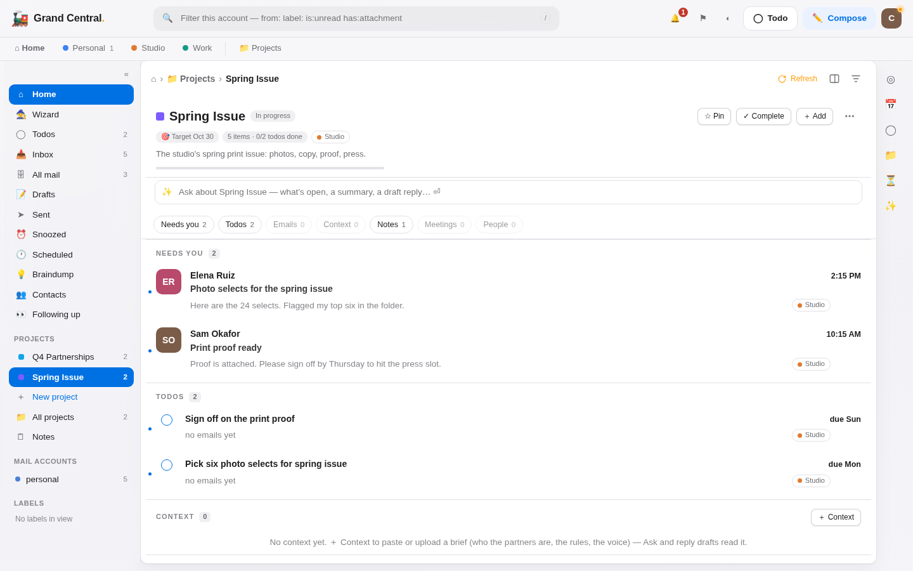
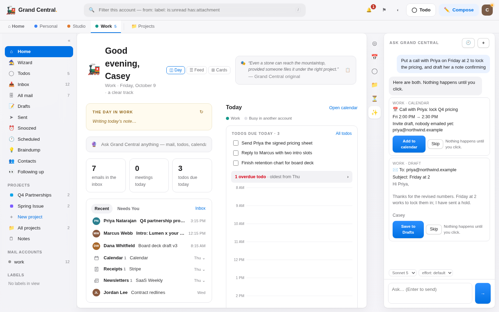
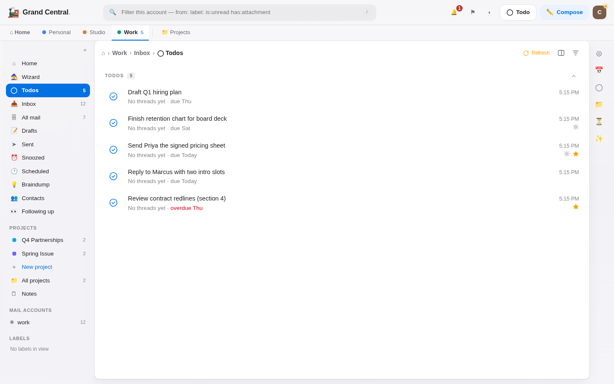
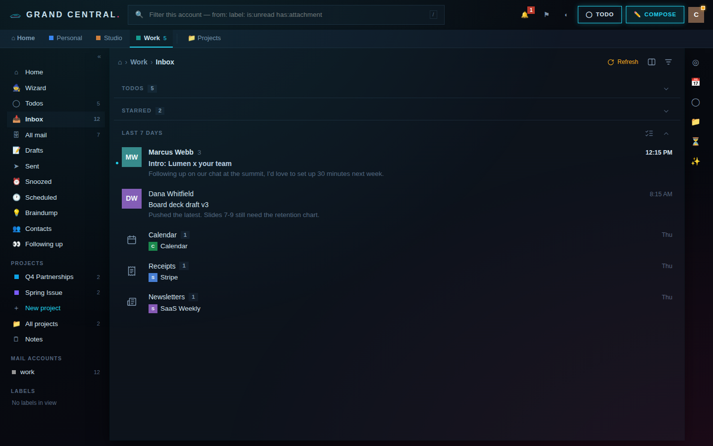
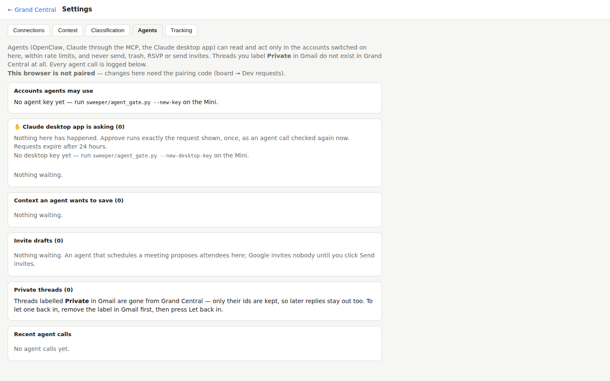

# Grand Central

**A self-hosted chief-of-staff board for people who run more than one job out of more than one inbox.**

Grand Central syncs several Gmail accounts, your Google calendars and your meeting notes into one local SQLite database, and serves a fast, keyboard-friendly web app: inboxes, todos, projects, notes, a day calendar, and a Claude-powered assistant that can read across all of it. Everything runs on one machine you own (a Mac mini under your desk works well); nothing is hosted by anyone else.



It is built around one idea: **every email and every todo belongs to exactly one account.** Work stays in work, the studio stays in the studio, personal stays personal, and you look at your life through one account at a time, or all of them at once on a read-only Home. Projects and notes are how you work *across* accounts without mixing them up.

---

## Contents

- [Try it in two minutes (demo data)](#try-it-in-two-minutes)
- [Screenshots](#screenshots)
- [Concepts](#concepts): accounts, email, todos, projects, notes, Home, calendar
- [AI: Ask, drafts and the daily brief](#ai-ask-drafts-and-the-daily-brief)
- [Agents: MCP, OpenClaw and the Claude desktop app](#agents-mcp-openclaw-and-the-claude-desktop-app)
- [Setting it up for real](#setting-it-up-for-real): Gmail, Google Calendar, Claude, Granola, Jev, remote access, push
- [Security model](#security-model)
- [Known rough edges](#known-rough-edges)
- [Development](#development)

---

## Try it in two minutes

No accounts, no keys. This fills a scratch database with made-up mail, todos and projects:

```bash
python3.11 -m venv .venv && .venv/bin/pip install -r requirements.txt
.venv/bin/python tools/demo_seed.py --db /tmp/gc-demo.db
GC_DB_PATH=/tmp/gc-demo.db GC_PORT=8090 .venv/bin/python dashboard/serve.py
# open http://127.0.0.1:8090
```

Three demo accounts (`work`, `studio`, `personal`), fourteen threads, ten todos and two projects. The AI parts stay quiet until you add a Claude key.

---

## Screenshots

| | |
|---|---|
|  **Inbox**, one account at a time: people first, then bundles (calendar, receipts, newsletters, updates). |  **A project** pulls emails, todos, notes and meetings from any account into one page. |
|  **Ask** answers from your mail and todos, and proposes actions as cards that do nothing until you click. |  **Todos** belong to one account and can carry that account's emails inside them. |
|  **Skins**: eleven of them, light and dark. This is *Neon*. |  **Settings → Agents**: which accounts agents may touch, what they asked for, and every call they made. |

---

## Concepts

### Accounts

An *account* is one mailbox (a Gmail or Google Workspace address) plus everything that belongs to it. Accounts are the navigation: the tabs across the top are your accounts, and every view (inbox, todos, drafts, search) is scoped to the one you're in. Add as many as you like; each is two lines in `config/.env`.

### Email

Grand Central reads your mail over IMAP every three minutes and keeps the headers locally, so the inbox is instant.

- **Sorting:** mail is sorted into *people* (real conversations) and *bundles*: calendar, receipts, newsletters, notifications and promotions. Your own company's mail and your teammates never land in promotions.
- **Triage:** *pin*, *snooze* (it leaves the inbox and comes back when you said), *done* (archives it in Gmail), *my day* (puts it on today's plan), and a sticky note per thread. Delete always means Gmail Trash, so it's recoverable.
- **Reading and replying:** a reading pane, a composer with recipient chips, scheduled sends, attachments, pasted images, and **Send with a 10-second Undo**. Sending only ever happens from your click in that composer.
- **Hidden threads:** label any thread `Private` in Gmail and it disappears from Grand Central entirely: not stored, not shown, never given to a model or an agent.
- **Optional:** open and click tracking for mail you send (a small Cloudflare Worker you deploy yourself).

### Todos

A todo belongs to exactly one account and can hold that account's emails (drag an email in, or create the todo from it).

- **Fields:** due dates, stars, priorities, notes, recurrence, snooze, and *My Day*.
- **Gmail labels:** a todo with emails gets a `GC/Todo/<name>` label in Gmail, kept in sync both ways, so your phone's Gmail app shows it too.
- **Wizard:** the 🧙 Wizard suggests todos from recent mail and meetings, for you to accept or skip.

### Projects

Projects are how you work *across* accounts without breaking the one-account rule. A project doesn't own anything: it **points at** emails, todos, meetings and people that stay in their own accounts. It has its own notes, a target date, *context documents* (a pasted or uploaded Markdown brief: who the partners are, the rules, the voice), and its own **Ask** that can read only what's filed in the project. When someone on a project writes to you, Grand Central offers "Add to *project*?".

### Notes

Notes live in the database, loose or inside a project, and are searchable from Ask.

### Home

Home is the one place that shows every account at once, each in its own section, with a single day calendar, todos due today, overdue counts and a short AI-written note about the day. Home is **read-only**: it never re-files or acts on anything across accounts.

### Calendar

Calendars are read from Google's private iCal links (no OAuth). Creating events on your own calendar, and RSVPing to invites, go through the [`gog`](https://github.com/steipete/gogcli) command-line tool. Guests are never invited without your explicit "Send invites" click.

### Contacts

People are pulled from your mail. You can mark VIPs and top prospects, write notes on anyone, and hide people you never want to see suggested.

---

## AI: Ask, drafts and the daily brief

Grand Central uses Claude through the Anthropic API (`ANTHROPIC_API_KEY`). Without a key the board still works; the AI features quietly switch off.

| Feature | What it does | Default model |
|---|---|---|
| **Assessor** | Hourly: a one-line summary, "needs a reply?" and importance for each thread, batched per account | Claude Haiku |
| **Day note** | A few sentences about the day on Home | Claude Haiku |
| **Wizard** | Suggests todos from mail and meeting notes | Claude Haiku |
| **Reply drafts** | Writes a reply into Gmail Drafts, in your voice, following your context documents | Claude Sonnet |
| **✨ in the composer** | Write from a prompt, or rewrite what you've drafted | Claude Sonnet |
| **✨ Ask** | A chat panel that reads your mail, todos, calendar, projects and notes | Sonnet by default; Opus or Fable from a picker |

**Ask** acts through the same validated actions as the buttons, never more. Adding or editing todos and saving reply drafts happen directly. **Calendar events, invites, new emails and thread triage are proposed as cards**: each card shows the exact event, email or change and does nothing until you click it. Ask cannot send, trash or bulk-edit, ever.

**Context** grounds every answer. Your *Context* notes are standing rules ("Jordan is our lawyer", "never quote prices in email"), and your context documents are longer briefs per account or per project.

**Prompt injection:** all email and calendar text reaching any model is fenced as untrusted data, and instruction-shaped text is defused and counted. This reduces prompt injection; it doesn't eliminate it. The real protection is structural: there is no send tool to misuse.

**Jev (optional):** TypeSafe's Jev can classify person-to-person mail (correspondence, prospect, cold pitch, update…) and judge whether it needs a reply. It's off by default and switched on per account. It sees the subject, the people on the thread and the first 400 characters of the latest message, never newsletters, notifications, full messages or attachments.

---

## Agents: MCP, OpenClaw and the Claude desktop app

`integrations/mcp/` is a small, dependency-free [MCP](https://modelcontextprotocol.io) server that exposes Grand Central to AI agents as typed tools: read the brief, list todos, read a thread, search mail, draft a reply, add a calendar event, triage a thread, and so on.

- **OpenClaw** or any MCP client: `.venv/bin/python integrations/mcp/gc_mcp.py`. See `integrations/mcp/README.md`.
- **Claude desktop app:** `gc_mcp.py --profile desktop` runs on the same machine, or over SSH from a laptop with a key that can run only that one command. `gc_ssh_proxy.py` keeps the laptop connected through sleep. Every read names one account.

**The board enforces the rules, not the agent.** Each agent has its own key, and `sweeper/agent_gate.py` checks every request:

- **Allowed actions:** an agent gets only the routes it's allowed. It can never send, trash, RSVP, send invites, change credentials or flip its own permissions.
- **Accounts:** it works only in accounts you switch on in Settings → Agents.
- **Private threads** don't exist for it.
- **Limits:** reads, searches, writes and data volume are rate-limited. Three refused calls in five minutes, or reading too many different threads, locks the agent out until you lift the lockout.
- **Audit:** every call is logged with its full arguments, and listed in Settings → Agents.
- **Held for approval:** a "remember that…" from an agent waits for your approval; agent drafts are labelled `GC/Agent-Draft`; proposed meeting guests wait for your Send invites click.

---

## Setting it up for real

### 1. Install

You need Python 3.11+ and macOS or Linux. On macOS, launchd keeps things running; on Linux, cron or systemd works.

```bash
git clone <this repo> ~/Code/GrandCentral && cd ~/Code/GrandCentral
python3.11 -m venv .venv && .venv/bin/pip install -r requirements.txt
cp config/.env.example config/.env && chmod 600 config/.env
cp config/projects.example.yaml config/projects.yaml   # optional: reply thresholds, key people
```

All credentials live in `config/.env`: plain `KEY=value` lines, never committed. The full list is in `config/.env.example`.

### 2. Gmail (required, one or more accounts)

Grand Central reads and files mail over **IMAP** and sends over **SMTP** with a Google **app password**. No OAuth app is needed.

1. Turn on 2-Step Verification for the Google account.
2. Create an app password at <https://myaccount.google.com/apppasswords>. For Google Workspace, an admin may need to allow app passwords.
3. Add two lines per account. The middle of the key is the account's short name (its *slug*):

```ini
GMAIL_WORK_USER=you@yourcompany.com
GMAIL_WORK_APP_PASSWORD=abcdabcdabcdabcd     # 16 characters, no spaces
GMAIL_PERSONAL_USER=you@gmail.com
GMAIL_PERSONAL_APP_PASSWORD=abcdabcdabcdabcd
SENDER_NAME=Your Name                        # the From name (or GMAIL_<SLUG>_NAME per account)
```

You can also add accounts later from **Settings → Connections**, which tests the login before saving.

### 3. Claude (strongly recommended)

```ini
ANTHROPIC_API_KEY=sk-ant-...
```

Get one at <https://console.anthropic.com>. The models used are set at the top of `sweeper/assess.py`, `sweeper/draft_reply.py` and `sweeper/command.py`.

### 4. Google Calendar

**To read** calendars, use each calendar's "Secret address in iCal format": Google Calendar → Settings → *your calendar* → Integrate calendar. Treat these URLs like passwords; Google refreshes them lazily, so new events can lag a little.

```ini
GCAL_ICS_URLS=https://calendar.google.com/calendar/ical/.../basic.ics,https://...
```

**To create events and RSVP**, install [gog](https://github.com/steipete/gogcli) (`brew install steipete/tap/gog`) and grant it calendar access once per account: `gog auth add you@yourcompany.com --services calendar`. If the jobs run headless under launchd, set `GOG_KEYRING_PASSWORD` so gog can unlock its keyring.

### 5. Granola meeting notes (optional)

```ini
GRANOLA_TOKEN=grn_...
```

This is an API key from Granola's settings. Grand Central reads the last day and a half of notes and pulls out action items for the Wizard.

### 6. Jev classification (optional)

```ini
JEV_API_KEY=...
```

Then switch it on per account in **Settings → Classification**.

### 7. Run it

Three processes:

| What | Command | How often |
|---|---|---|
| The board | `.venv/bin/python dashboard/serve.py` | always on (port 8080) |
| Mail sync | `.venv/bin/python sweeper/mail_sync.py` | every 3 minutes |
| Sweep | `.venv/bin/python sweeper/sweep.py` | hourly in working hours |

Ready-made launchd files are in `config/*.plist`. Edit the paths and labels to match your machine, copy them to `~/Library/LaunchAgents/`, then `launchctl load` them.

The board accepts connections only from this machine and from your [Tailscale](https://tailscale.com) network. Set `GC_ALLOW_LAN=1` to allow your local network too.

### 8. Pair your browser

Sending, trashing, changing connections and other sensitive actions need a *paired* browser. Create a code on the machine, then enter it on the board when it asks:

```bash
.venv/bin/python sweeper/dev_pairing.py --new
```

### 9. Reach it from anywhere (optional)

- **Tailscale** is the simplest: install it on the host and your devices, then browse to the host's Tailscale name on port 8080.
- **Cloudflare Tunnel plus Cloudflare Access** works from networks that block VPNs. Put an Access login in front *before* starting the tunnel. See `TUNNEL_SETUP.md`.
- **Phone:** the board is a progressive web app; add it to your home screen. Web push alerts need HTTPS and a VAPID key pair (`VAPID_PUBLIC_KEY`, `VAPID_PRIVATE_KEY`, `VAPID_SUBJECT`).

### 10. Agents (optional)

```bash
.venv/bin/python sweeper/agent_gate.py --new-key           # the MCP / OpenClaw key
.venv/bin/python sweeper/agent_gate.py --enable work       # which accounts agents may use
.venv/bin/python sweeper/agent_gate.py --new-desktop-key   # the Claude desktop app's key
```

Then follow `integrations/mcp/README.md`.

---

## Security model

Every widening of what the system may do is written down as a dated decision in `BUILD_SPEC.md` §6. The non-negotiables:

- **One send path:** your click in the composer, with a 10-second Undo, ≤10 recipients, logged. No AI tool, Ask, agent or script can send.
- **Delete means Gmail Trash**, which is recoverable. There is no purge.
- **Calendar writes are create-only** on your own calendars. Guests are invited only by your click.
- **Credentials live only in `config/.env`** (mode 600) or the keychain, and are never returned by any endpoint.
- **Who can connect:** the server accepts only local and Tailscale connections, and rejects cross-site POSTs.
- **Agents** are policed by the board itself (see above), and `Private`-labelled threads never enter the system.

---

## Known rough edges

This started as one person's tool, and a few things still assume one setup:

- **Calendar to account:** which calendar belongs to which account is decided by calendar name in `sweeper/sources/calendar_reader.py` and `sweeper/home_view.py`. Adjust both for your accounts.
- **Event creation** (`sweeper/calendar_writer.py`) only knows two account slugs; add yours to `ACCOUNT_EMAIL_KEYS`.
- **Open and click tracking** defaults (`sweeper/tracking.py`) and the Worker config (`integrations/tracker/`) name example domains; set your own.
- **launchd plists and `auto_pull.sh`** contain example paths and labels.
- **No setup wizard yet:** setup is `config/.env` plus Settings → Connections, and your browser must be paired before Connections can save.
- **Docs:** `BUILD_SPEC.md` §1–5 describes an earlier design and is kept as history; `CLAUDE.md` and `ACCOUNT_FIRST.md` describe how it works now.

---

## Development

```bash
.venv/bin/python -m unittest discover -s tests    # the full offline suite (scratch databases, a fake Claude)
.venv/bin/python sweeper/dev_check.py             # syntax gate: Python, plus every inline <script>
.venv/bin/python sweeper/selftest.py              # checks against a running board
```

The backend is mostly the Python standard library; the whole front end is `dashboard/index.html`, plain JavaScript with no build step. `CLAUDE.md` is the best map of the code. In code comments, *Casey* is the stand-in name for the owner.
